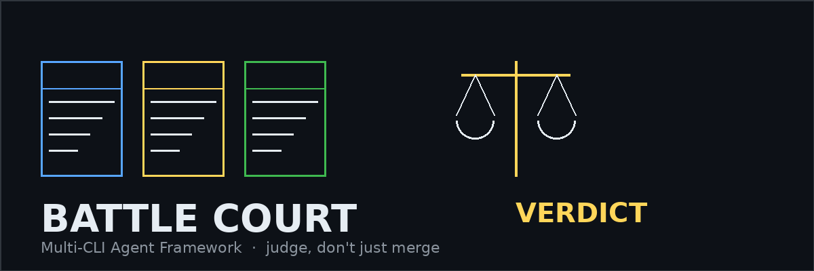
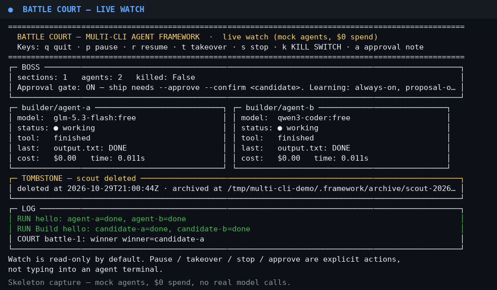
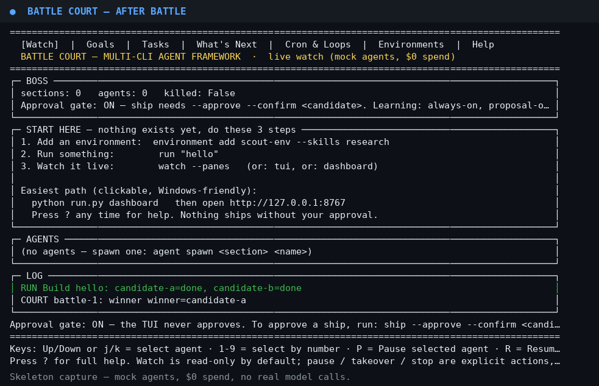
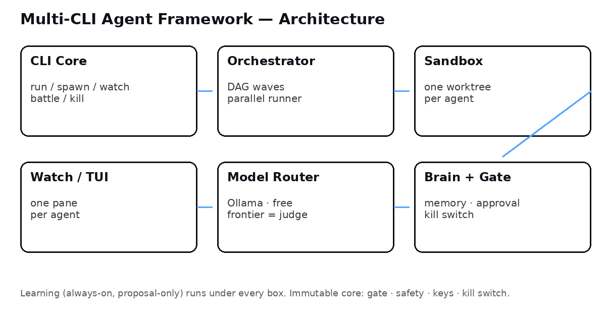

# Battle Court — Multi-CLI Agent Framework


<p align="center">
  
</p>

<p align="center">
  
</p>

**Parallel agents can produce code. Nobody reconciles it — semantically,
with evidence, and then learns from the reconciliation.**

Battle Court is the **Verdict Layer above the fleet**: it runs CLI agents
in parallel, in their own environments, watches them live, judges their
work in court, and learns from every verdict — without ever auto-shipping
anything.

It is vendor-neutral and model-neutral: it *runs* CLI agents, it does not
compete with them on being a better single agent. It is a brand-new
project, separate from Robot Orchestra. No Jarvis branding.

## Screenshots — the actual UI

These are real captures of the actual UI running in this repo
(skeleton, mock agents, $0 spend, no real model calls — see
[Honest status](#honest-status) at the bottom).

### Live watch — split panes, one per agent + Boss + log



Text capture: [`docs/screenshots/tui-watch.txt`](docs/screenshots/tui-watch.txt)

### After a battle — winner staged, loser archived, never auto-shipped



Text capture: [`docs/screenshots/tui-battle.txt`](docs/screenshots/tui-battle.txt)

> **Windows note:** the PNGs above are rendered from the real
> `watch --panes` text output (same layout, same data) because this
> build machine has no Windows terminal render. On Windows, run
> `python run.py tui` for the interactive curses/ANSI UI — the pane
> layout is identical, and a real Windows screenshot is still needed
> to prove it renders there (see Honest status).

## Quickstart

```bash
# Python 3.10+, no dependencies, no install step
python3 -m unittest discover -s tests -v   # 24 tests, offline, mock agents only

python3 run.py run "hello"                 # 2 parallel agents, 2 sandboxes, live watch
python3 run.py tui                          # the actual UI (interactive where curses exists)
python3 run.py watch --panes                # the same panes as capturable text
python3 run.py watch --json                 # the same state as a machine-readable stream

python3 run.py battle --task "Build hello" --pick a
python3 run.py ship --candidate candidate-a            # BLOCKED by the approval gate
python3 run.py ship --candidate candidate-a --approve --confirm candidate-a
```

Or `python -m framework run "hello"` from this folder.
Use `--root <dir>` to keep `.framework/` state out of this repo.

## Features

- **Parallel, isolated** — one agent = one sandbox + one watch pane.
  Agents never share a working directory, so they cannot overwrite
  each other. One dead agent never kills a wave.
- **Dynamic spawn / delete, live, no restart** — add a section, spawn
  an agent, kill or pause one, delete a section, all while the rest
  keep running. Delete = archive by default; wipe needs the exact
  section name twice-confirmed. There is no wipe-all.
- **Live watch TUI** — split panes: Boss, one pane per agent
  (name, model, status, current tool, last output, cost, time), and
  a log pane. Watch is read-only by default. Keys are explicit
  actions, never typing into an agent's terminal:
  `q` quit · `p` pause · `r` resume · `t` takeover · `s` stop ·
  `k` **kill switch** · `a` approval note (the gate is never
  bypassed by the TUI).
- **Contract Registry** — agents declare files, APIs, and schemas
  *before* coding. Cross-agent conflicts are flagged before coding,
  not after a merge breaks the build.
- **Battle Court** — judge, don't just merge. Same task, two
  candidates, separate sandboxes. Automated judging first (tests,
  lint, contract check, evidence bundle — **no bundle, no win,
  fail-closed**), human pick second, side-by-side. Winner is
  **staged for approval only — never auto-merged, never auto-shipped**.
  Loser is stopped and archived with reasons. Tie / neither: both
  archived.
- **Model router** — local first (Ollama `127.0.0.1:11434`),
  OpenRouter free next, frontier only for planner / judge with a
  cost cap and explicit approval. Fallback: free → local → pause.
  **Never silently upgrades to paid.**
- **Always-on learning — not a mode** — every run, battle, and
  verdict is a learning event, in every mode. At most **one rule
  change per cycle**, human approval before it takes effect, and
  the immutable core below can never be touched by learning.

## Architecture



### Sections

| Section | Folder | What it does |
|---|---|---|
| CLI Core | `framework/cli.py` | `run / spawn / watch / battle / rea / status / kill`, headless `--json` + TUI |
| Orchestrator | `framework/orchestrator.py` | DAG waves, parallel runner, one dead agent never kills a wave |
| Sandbox | `framework/sandbox.py` | One isolated directory per agent; containers later, never required to start |
| Watch / TUI | `framework/tui.py`, `framework/watch.py` | Split panes + JSON stream; tombstones for deleted sections |
| Model Router | `framework/router.py` | Per-agent model, failover, cost caps, free-only filter |
| Brain + Gate | `framework/brain.py`, `framework/gate.py`, `framework/learning.py` | Local file-first memory, approval gate, kill switch, learning guard |

## Commands

```bash
python3 run.py run "hello"
python3 run.py tui | python3 run.py watch --panes | python3 run.py watch --json
python3 run.py section add builder --role builder
python3 run.py section list
python3 run.py section delete builder            # archive by default
python3 run.py section delete builder --wipe --confirm builder
python3 run.py agent spawn builder agent-1 --model local
python3 run.py agent kill builder agent-1
python3 run.py agent pause builder agent-1
python3 run.py contract declare --agent agent-1 --file src/app.py --api /users
python3 run.py contract check
python3 run.py battle --task "Build hello" --a glm-5.3-flash:free --b qwen3-coder:free --pick a
python3 run.py ship --candidate candidate-a --approve --confirm candidate-a
python3 run.py learn propose --rule "route build to glm first" --target build
python3 run.py learn apply --index 0 --approve
python3 run.py kill                               # kill switch: stop everything instantly
python3 run.py rea <target>                      # read-only skeleton placeholder (see below)
```

## Battle Court, in detail

1. **Declare** — `contract declare` before coding.
2. **Run in parallel, isolated** — one worktree/sandbox per agent.
3. **Judge** — automated checks first (tests, lint, contract,
   evidence bundle, cost, time), human pick second.
4. **Stage, don't ship** — winner goes to `.framework/staged/`
   with `shipped: false`. Only `ship --approve --confirm <name>`
   passes the gate, and the skeleton performs no real ship.
5. **Archive the loser** — stopped, frozen, with reasons, under
   `.framework/archive/`.

## Contract Registry, in detail

```bash
python3 run.py contract declare --agent builder-a --file src/app.py --api /users --schema User
python3 run.py contract declare --agent builder-b --file src/app.py --api /users
python3 run.py contract check   # flags the shared src/app.py + /users conflict BEFORE coding
```

## Dynamic sections and agents, in detail

- The live registry (`.framework/state.json`) is the single source
  of truth. Adding or removing an entry hot-reloads only that
  section — the framework does not restart, other sections do not
  restart, in-flight waves elsewhere are untouched.
- Deleting a section mid-run shows a **tombstone** in the TUI
  ("Section X deleted, archived at …, other panes kept running")
  and frees its wave slot. It never crashes the watch screen and
  never pretends the deleted work succeeded.
- Deleting the last agent in a section does **not** delete the
  section — it stays, empty, until you delete it.

## Always-on learning, with an immutable core

Learning is a permanent layer under every mode — normal, battle,
solo, watch, REA — always on, learning from every run:

1. **Collect** — every run writes an event log (task, model, prompt,
   tools, result, cost, approval outcome).
2. **Propose, at most one rule per cycle** — one rule, one diff,
   with evidence attached.
3. **Human approval before it takes effect** — approve, edit, or
   reject. Nothing auto-applies.
4. **Apply + measure** — if it made things worse, the next cycle
   proposes reverting it, again with approval.

**Immutable core — learning can NEVER change these, ever, enforced
in code + a config file the learning loop has no write access to:**

- Approval gate — cannot weaken, skip, or auto-approve
- Safety / scrub lists — cannot remove entries or add exceptions
- Keys / credentials — never read, written, moved, rotated, or logged
- Kill switch — always works instantly
- No auto-send / ship / pay / delete / merge — learning proposes
  routing / prompt changes only, never executes those actions

A proposal touching the core is auto-rejected before it ever
reaches a human. The worst a bad proposal can do is waste one
approval click.

## Skills, MCP, and Brain — what agents actually run off

An agent run is **model + skills + MCP tools + Brain context**, not
just a prompt:

- **Skills** (`skills/`, Markdown playbooks): `code-review`,
  `test-runner`, `research`, `battle-judge`. List with
  `skill list`, add one with `skill add --file <path>`, use one with
  `skill use <agent> <skill>`. Every skill use is recorded in the
  Brain, so a run is auditable.
- **MCP** (`mcp.yaml` registry): servers with a command, stdio
  transport, tool list, and allow-list. `mcp list`, `mcp add`,
  `mcp call --server <s> --tool <t>`. Skeleton calls are **mocks,
  clearly labelled, no real server or network required to test**.
  A dangerous MCP tool (send/ship/pay/delete/merge) is blocked by
  the approval gate without explicit approval, every time.
- **Brain** (local, file-first, no vector DB, no external service):
  events for runs, skill uses, MCP calls, battle verdicts, goals,
  tasks, loops, and learning. `brain search <term>`,
  `brain show <id>`, `brain list`. An agent consults relevant past
  events before it starts; that context is recorded on its run.

## Goals, Tasks, What's Next, Environments, Cron & Loops

- **Goals / Tasks / Deliverables** — stored locally in state, not a
  new database: `goal add/list/progress`, `task add/list/status`,
  `deliverable add/list/status`. What's Next is deliverables in due
  order, open first. The TUI renders them as tabs:
  `tabs` (Goals / Tasks / What's Next / Cron & Loops / Environments),
  selectable in the curses TUI (g / t / w / c).
- **Environments** — one action for a new agent:
  `environment add <name> --model <m> --skills <s...> --mcp <s/t...>`.
  It creates a section + agent + sandbox + model + skills + MCP
  bundle, live, no restart. Deleting it uses normal section delete
  (archive by default).
- **Cron & Loops** — local scheduler, file-based, no cloud service:
  `cron add <name> --schedule 'every 60 minutes' --task <task>`,
  `cron list/delete/due`; `loop --mode repeat|until_success|gated
  --max N`. A gated loop re-checks the approval gate **before every
  iteration** that would send/ship/pay/delete/merge — a loop can
  never auto-ship on any iteration. The kill switch stops all loops
  and cron jobs instantly. Loop + cron runs are logged to the Brain.

## Configuration

- `framework.yaml` — sections, approval gate, sandbox, learning
  (example starting point, not a fixed fleet — sections are dynamic)
- `router.yaml` — model tiers and fallback chains (data, not code;
  learning proposes changes to this file, never rewrites it silently)

## Contributing

1. Keep it local-first, vendor-neutral, and approval-gated.
2. Every new feature needs a test, and the test must pass offline
   with mock agents before any real model runner is wired in.
3. Never add a paid-model default, a silent upgrade, an auto-ship,
   or a learning rule that touches the immutable core.
4. Screenshots must be real captures of the actual UI, labelled
   as mock/skeleton where that is true — never fake a real model run.

Regenerate screenshots any time the UI changes:

```bash
python3 scripts/capture_screenshots.py   # docs/screenshots/*.txt + *.png
python3 scripts/make_assets.py           # docs/assets/hero.png, icon.png, favicon.png, architecture.png
```

## Honest status

- **Skeleton, v0.1.0-skeleton. Not released. No installer, no
  pricing, no payment system, no release date.**
- Agents in this skeleton are **mocks, $0 spend, no real model
  calls** — tests are code + mock proof only, not model proof.
- **Not yet done:** Semantic Merge v1; full evidence bundles
  (v1: file+line, test, unknowns); Evolution Engine full (v1:
  proposal guard + one-rule apply, weekly cycle is config, not a
  scheduler); REA inspect (skeleton command is a read-only
  placeholder — morluto/rea MCP + Ghidra evidence is not wired);
  real MCP server protocol (skeleton MCP calls are mocks, registry +
  allow-list + gate + logging are real); real skill marketplace;
  vector Brain (search is substring over local events, by design);
  vendor runners (Codex, OpenCode, Pi, Goose, Crush, etc.);
  real curses TUI on Windows (stock Windows Python has no curses —
  `watch --panes` is the portable UI there, `watch --tui` is
  interactive where curses exists).
- **Still needs a Windows live run to prove it:** `run "hello"`
  and `battle` on Windows, a real model/CLI runner replacing
  `MockAgent`, a real TUI pane render on a Windows terminal, and
  a real approval-gate ship flow.

## Licence

MIT — see [LICENSE](LICENSE).
